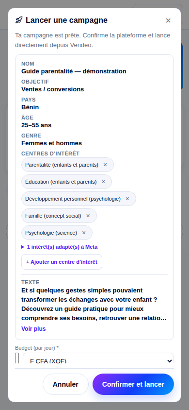

# Assistant : intérêts Meta réels et lancement explicite

Les intérêts présélectionnés proviennent exclusivement des réponses du catalogue Meta : leurs `id` et `name` sont conservés tels quels. Un libellé sans correspondance sûre reste à `selected: null`. Le seul déclencheur de création de campagne est désormais le clic sur **Confirmer et lancer**.

## Vérification réelle du catalogue

Le compte de test initial renvoyait HTTP 402. Avec l’autorisation de Marioce, les lectures suivantes ont été effectuées sur son compte personnel, sans lancement ni modification de campagne.

Un vrai POST sur l’`interest-resolve` actuellement en production, avec les sept libellés et `locale: fr_FR`, a répondu HTTP 200 : les sept champs `exact` étaient nuls, alors que les cinq premiers intérêts figuraient dans les suggestions. Cela reproduit le défaut de la PR #220.

Le handler POST **modifié localement** a ensuite été exécuté avec des réponses fraîches du même catalogue que le parcours manuel. Un pont temporaire transmettait chaque recherche à l’endpoint authentifié existant `/api/integrations/meta/interest-search`. Seuls l’authentification et le chargement du compte dans le harnais local étaient doublés ; les recherches, leurs candidats et les objets sélectionnés étaient réels. Aucun cookie ni jeton n’a été lu ou exporté. Ce test ne constitue pas un déploiement du nouveau handler ni un test HTTP de son authentification locale.

Résultat HTTP 200 du handler local :

| Libellé demandé | `selected.id` | `selected.name` | `confidence` | `suggestions` |
| --- | --- | --- | --- | --- |
| Parentalité | 6002991239659 | Parentalité (enfants et parents) | base | [] |
| Éducation des enfants | 6003232518610 | Éducation (enfants et parents) | close | [] |
| Développement personnel | 6003400407018 | Développement personnel (psychologie) | base | [] |
| Famille | 6003476182657 | Famille (concept social) | base | [] |
| Psychologie | 6003224104145 | Psychologie (science) | base | [] |
| Relations familiales | null | — | null | Les trois objets ci-dessous |
| Conseils parentaux | null | — | null | [] |

Suggestions du catalogue pour « Relations familiales », sans aucune présélection :

- `6003206992086` — Gestion de la relation clientèle (relations publiques)
- `6003779590652` — Investor relations
- `6003343734074` — Public Relations Society of America (PRSA)

Ces suggestions ne sont pas présentées comme des correspondances sûres. L’algorithme conserve le classement demandé, mais ne sélectionne aucun de ces objets pour « Relations familiales ».

**Appels de recherche : 15 avant, 13 après.** Le nombre avant correspond aux requêtes complètes et de repli de l’ancien code pour ces sept libellés ; le nombre après a été mesuré sur les 13 requêtes réelles du pont. Aucun échec de recherche. Les requêtes de repli sont évitées dès qu’une réponse complète fournit une correspondance exacte ou de base. La réponse et tous les candidats reçus sont conservés dans [la preuve JSON](meta-interest-live-proof.json).

## Tests et build

- `npx tsc --noEmit` : code de sortie 0, aucune erreur.
- `npm run build` : code de sortie 0.
- `npm test` sur le code final : **2 213 réussis, 26 échoués, 2 239 au total**.
- Même commande sur `origin/main` (`9b75ca731180c4a884111527ccb8863806fdb151`) : **2 202 réussis, 26 échoués, 2 228 au total**. Les noms des 26 échecs sont identiques ; aucun nouvel échec.
- Les sept fichiers directement concernés totalisent **117 tests réussis**, dont les tests legacy `tests/chat-launch-interests.test.ts`.
- Test temporaire du handler avec recherches Meta réelles : **1/1 réussi** ; le harnais réseau a été retiré du dépôt après conservation des résultats.

Les échecs préexistants concernent l’acceptation d’inscription, le chargement admin, les soldes Studio, la documentation, le guide de bienvenue, des parcours Studio/vidéo et une revalidation de média Meta. Ces modules n’ont pas été modifiés pour contourner leurs tests.

## Carte mobile

Capture du vrai composant `ChatView` dans un harnais local, avec les cinq résultats Meta enregistrés ci-dessus. Le texte publicitaire, le compte et la page affichés sont des données de démonstration. Tous les endpoints de campagne sont désactivés dans ce harnais.

À 390 × 844 px : document 390 px, modale 358 px, corps 328 px et largeur défilante 328 px. À 360 × 844 px : document 360 px, modale 328 px, corps 298 px et largeur défilante 298 px. Aucun débordement horizontal ; aucun texte de la carte centré par erreur. Dans les deux cas, le corps défile verticalement et le pied d’action reste visible.

Les styles dédiés gèrent les puces, les suggestions arrondies, les détails repliés, la recherche manuelle limitée à 220 px, la modale en colonne, l’aperçu limité à 140 px et le texte publicitaire limité à quatre lignes avec « Voir plus ».

## Fichiers modifiés

- `lib/ad-campaigns/meta-targeting.ts`
- `lib/ad-campaigns/meta-targeting.test.ts`
- `app/api/integrations/meta/interest-resolve/route.ts`
- `app/api/integrations/meta/interest-resolve/route.test.ts`
- `components/ChatView.tsx`
- `app/vendeo-ai.css`
- `app/api/chat/route.ts`
- `app/api/chat/route.test.ts`
- `tests/chat-launch-interaction.test.tsx`
- `tests/chat-launch-progress.test.tsx`
- `docs/qa/meta-interest-confirmation.md`
- `docs/qa/meta-interest-live-proof.json`
- `docs/qa/meta-interest-card-390.png`

`normalizeInterestLabel`, `resolveExactMetaInterests`, le parser de `[[LANCE_CAMPAGNE]]`, `Step3Audience.tsx`, la route legacy de lancement et sa vérification des objets sont inchangés. La signature `openLaunchConfirm(parsedReply.launchPayload, collectLaunchMedia(campaignHistory), campaignHistory)` est préservée. Les changements locaux sans rapport dans le worktree principal, la PR #185 et le code Diaporama n’ont pas été touchés.

Aucune vraie campagne n’a été créée ou modifiée. Aucun déploiement n’a été déclenché par cette validation.
